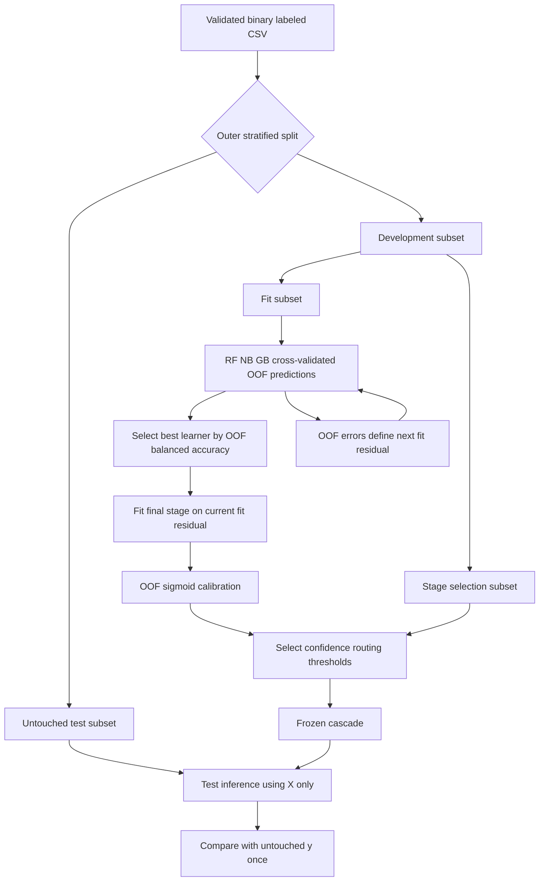

# Architecture and mathematical semantics

## Scope

The current CaRSEL-CVD implementation is a **research prototype** that makes
explicit the boundary between supervised stage construction and label-free
predictions. It deliberately differs in some respects from the source
manuscript; this must be transparently documented in any publication.

## Model/flow

This diagram is conceptual. OOF error subsets are recursively defined inside
**FIT**; SEL is used only for routing thresholds, and TEST is untouched until
all estimators and thresholds have been frozen.

## Selection and residual definition

At stage \(\ell\), candidate \(h\) is scored using OOF predictions on the
current fit-only residual subset \(R^\text{fit}_\ell\):

\[
 h_\ell^*=\arg\max_{h\in\{\mathrm{RF},\mathrm{NB},\mathrm{GB}\}}
 \mathrm{BalancedAccuracy}(y_{R_\ell},\hat y_{h,\mathrm{OOF}}).
\]

The succeeding fit residual is

\[
R^\text{fit}_{\ell+1}=\{(x_i,y_i)\in R^\text{fit}_\ell:
\hat y^{\mathrm{OOF}}_{\ell,i}\ne y_i\}.
\]

This is **not** the same as the user-provided original argmax over counts of
correct predictions in \(\mathcal R_\ell\), nor is it a weighted ensemble.
The scientific reason for this variant is to avoid generating residuals from
in-sample predictions. The selected stage is fitted on the current residual,
not trained by moving correctly classified samples to a cumulative pool.

The actual inference gate is

\[
 g_\ell(x)=\mathbb 1[\max_c\hat p_\ell(c\mid x)<\tau_\ell].
\]

A record exits when \(g_\ell(x)=0\), otherwise advances to the next stage;
unresolved records enter a fitted KNN. No test label is referenced during
prediction. A logistic sigmoid calibrator for stage probabilities is fitted on
OOF candidate scores in FIT. The gate thresholds are selected by an empirical
constraint on prediction error among high-confidence exits on DEV-SEL.
These are *descriptive* thresholds, not statistical upper risk bounds.

## Training and API responsibilities

- `data.py` validates input values and can optionally remove invalid rows.
- `training.py` handles all labeled data operations and stage selection.
- `model.py` contains frozen inference-only objects (no `y` parameter).
- `store.py` handles trusted local model persistence.
- `api.py` validates single patient inputs, returns traces, and can launch
  authorized local training.
- `web/` is a standalone single-origin frontend and has no build system.

## Known limitations

1. No attempt is made to recover the unknown EAWV weight estimation rules.
2. No guarantee exists that a high-confidence prediction is correct.
3. The current experimental report evaluates a single external split and
   therefore requires repeated CV, nested selection and external validation.
4. The model may perform poorly if the source distribution changes.
5. This release does not estimate generalization performance from cumulative
   residual case resolution.
6. No feature attribution is claimed; the trace is a **routing trace**, not a
   causal explanation or clinical feature-level explanation.
7. No publication-quality comparison or multi-dataset benchmarking is included.
8. Brier score is provided; ECE and full reliability plots are planned.
9. Very small residual subsets cause cascade construction to stop, and the
   KNN fallback is then trained on the complete fit pool; this is reported.

## Upgrading to faithful replication of the original CaRSEL

Provide the original Python or notebook implementation, source dataset,
partitions, source `jj21.png`, hyperparameters, EAWV formula/weights and
per-layer logs. Reconcile the original stage-transfer semantics with the
leakage-controlled variant as two explicitly named modes. Repeat all
experiments before claiming numerical equivalence.
